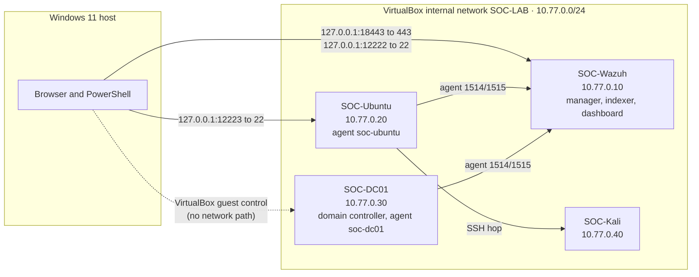

# Lab architecture

## Host

One Windows 11 PC running VirtualBox 7.2.22. The virtual machines live in `D:\Home SOC Lab`. All guests share one VirtualBox **internal network** named `SOC-LAB` (10.77.0.0/24, static addresses, no DHCP, no router). The host has no interface on that network.

## Guests

| VM | Operating system | Lab address | Other adapters | Role |
| --- | --- | --- | --- | --- |
| `SOC-Wazuh` | Wazuh 4.14.10 appliance (Amazon Linux) | 10.77.0.10 | NAT, for updates and the host's loopback forwards | Manager, indexer and dashboard |
| `SOC-Ubuntu` | Ubuntu 24.04 | 10.77.0.20 | NAT, for packages and the host's loopback forward | Linux endpoint, Wazuh agent `soc-ubuntu` |
| `SOC-DC01` | Windows Server 2025 Standard Evaluation (Desktop Experience) | 10.77.0.30 | none | Domain controller for `soclab.internal`, Wazuh agent `soc-dc01` |
| `SOC-Kali` | Kali Linux 2026.3 | 10.77.0.40 | none | Second Linux guest on the lab network |

## How the host reaches each guest

- **Wazuh dashboard.** `https://127.0.0.1:18443`, a NAT port forward bound to the host's loopback address.
- **Wazuh and Ubuntu shells.** SSH through loopback forwards on ports 12222 and 12223. [`Invoke-LabVm.ps1`](../scripts/host/Invoke-LabVm.ps1) and [`Ubuntu-SSH.ps1`](../scripts/host/Ubuntu-SSH.ps1) send a script on standard input and run it as root.
- **Kali.** No adapter the host can reach. [`Kali-SSH.ps1`](../scripts/host/Kali-SSH.ps1) hops through Ubuntu.
- **Windows.** No adapter the host can reach, on purpose. [`Invoke-DcGuest.ps1`](../scripts/host/Invoke-DcGuest.ps1) uses VirtualBox guest control (Guest Additions) to copy a script into the guest and run it.

Nothing in the lab listens on the home network. The forwards bind to 127.0.0.1 only.

## Isolation rules for the Windows server

Active Directory, DNS and SMB must only ever listen on the lab network.

- During installation the VM had a temporary NAT adapter for activation and for downloading the agent installer. It was removed before the server became a domain controller.
- The promotion script ([`30-promote.ps1`](../scripts/windows-guest/30-promote.ps1)) refuses to run if any adapter other than the lab adapter exists, if a default route exists, or if the address is not 10.77.0.30.
- The lab adapter has no default gateway.
- The forest (`soclab.internal`, NetBIOS `SOCLAB`) is lab-only and uses fictional identities only.

## Credentials

- Every password is generated, never chosen, and stored with `Export-Clixml` in `%LOCALAPPDATA%\Home SOC Lab`. Those files are encrypted with Windows DPAPI for one user account on one PC and are useless elsewhere.
- No password appears in this repository, in the scripts, or on a command line. Scripts read the credential files at run time.
- Two tools insist on a plaintext password file (`VBoxManage unattended install` and `VBoxManage guestcontrol`). The helpers create that file in the user's temp folder, use it, and delete it in the same call.
- Secrets a guest script needs (for example a new user's password) travel into the guest as a file through guest control and are deleted by the script that reads them.
- Windows was installed with a throwaway password, replaced inside the guest as the first step after Setup, because the unattended installer writes the password it is given into an answer file and prints it.

## Snapshots

| VM | Snapshot | State |
| --- | --- | --- |
| `SOC-DC01` | `clean-install` | Windows installed and activated, lab adapter only, agent installer downloaded |
| `SOC-DC01` | `dc-promoted` | Domain controller for `soclab.internal`, Wazuh agent active, no lab objects yet |
| `SOC-DC01` | `ad-evidence` | After the access-control exercise |
